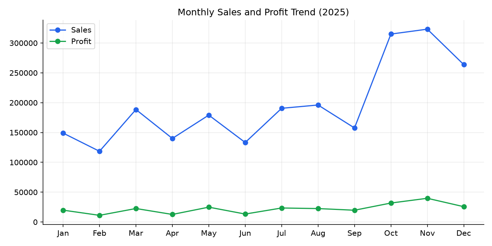
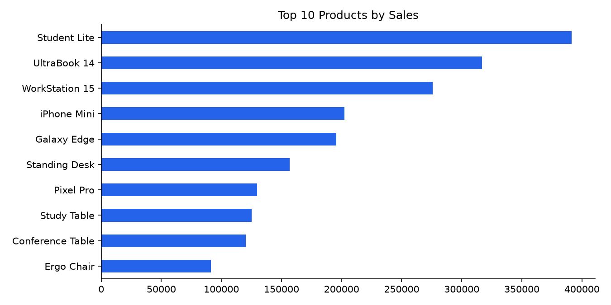
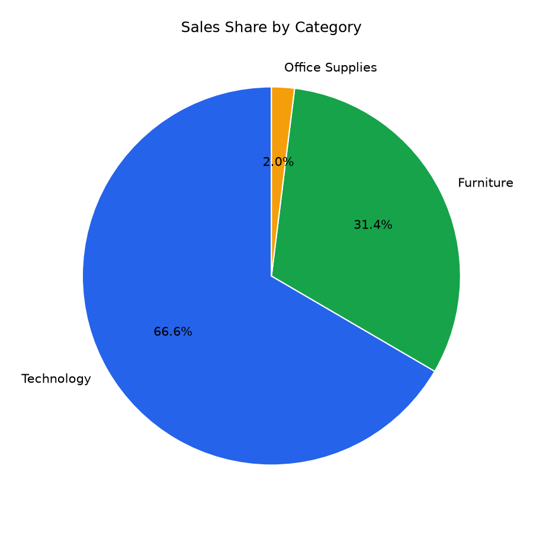
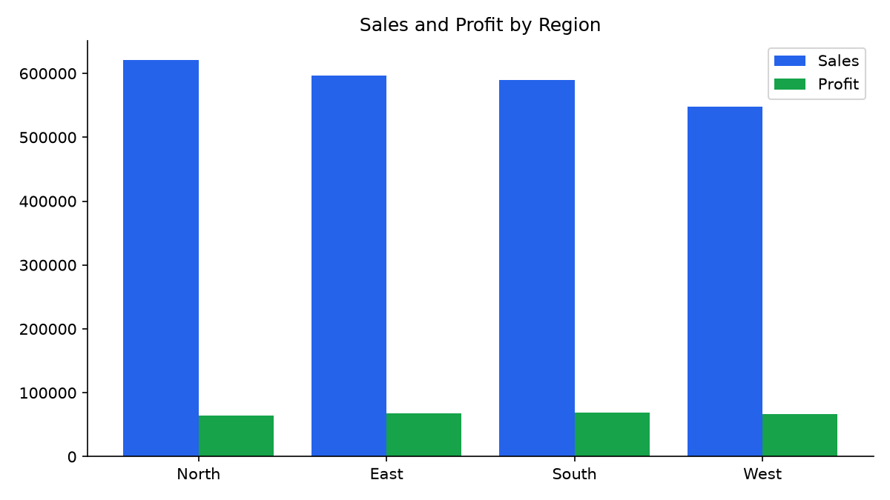
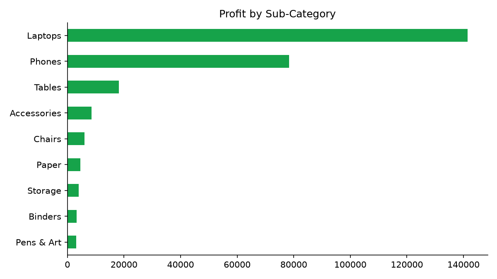

# Sales Performance Analysis - Project Report

**Dataset:** Retail sales, Jan-Dec 2025 (2,002 order lines, 2,000 orders)
**Tools:** Python (pandas, matplotlib), interactive HTML dashboard, Power BI

## 1. Objective
Analyse monthly sales performance of a retail business, identify the best products,
categories and regions, and highlight where profit is being gained or lost.

## 2. Data Preparation
Duplicates removed, blanks filled (Sales recomputed from Unit Price x Quantity x (1 - Discount)),
text trimmed, Category casing standardised, dates converted and Month/Quarter columns added.
See `report/cleaning_log.txt`.

## 3. Key Metrics
| Metric | Value |
|---|---|
| Total Sales | 2,354,700 |
| Total Profit | 267,525 |
| Profit Margin | 11.4% |
| Total Orders | 2,000 |
| Average Order Value | 1,177 |

## 4. Insights
1. **Top category:** Technology generates the most sales (1,568,083, 66.6% of total).
2. **Most profitable category:** Technology (228,360 profit).
3. **Best region:** North leads with 620,693 in sales; West is the weakest (547,420).
4. **Top product:** Student Lite (391,591 sales).
5. **Seasonality:** Nov was the best month (323,170) and Feb the weakest (118,525). Q4 contributes 38.3% of annual sales.
6. **Loss-making sub-categories:** None.
7. **Customer segments:** Small Business is the largest segment (33.4% of sales).

## 5. Recommendations
- Increase stock and marketing before Q4, the peak season.
- Review discounting on low-margin items, since higher discounts reduce profit.
- Monitor low-margin sub-categories and review their pricing and costs.
- Push campaigns in the weakest region (West) to close the gap with North.
- Promote top-selling products with bundles and cross-selling.

## 6. Charts

